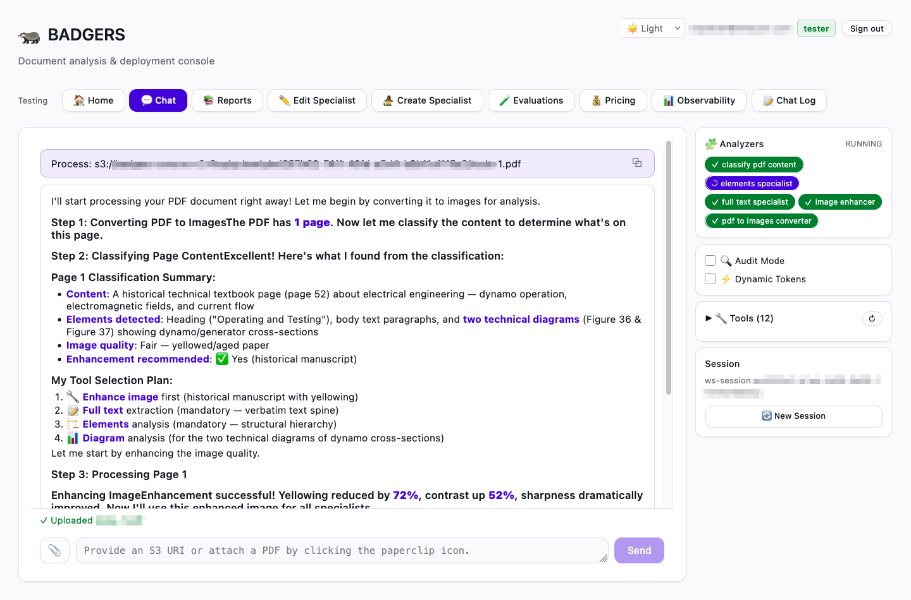
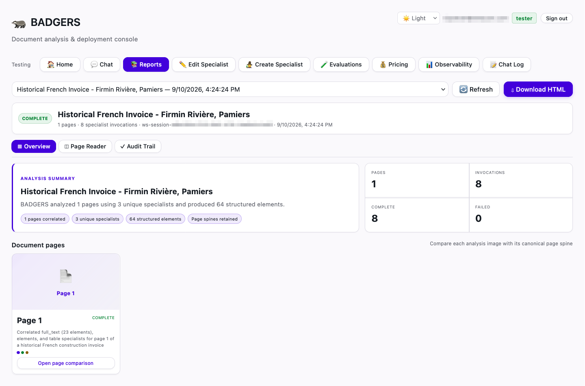

# 🦡 BADGERS

> **Broad Agentic Document Generative Extraction & Recognition System**

[](RELEASE_GUIDE.md)
[](pyproject.toml)
[](deployment/DEPLOYMENT_README.md)
[](https://github.com/strands-agents/strands-agents)
[](https://aws.amazon.com/bedrock/agentcore/)
[](https://modelcontextprotocol.io/)
[](LICENSE)
[](.ash/ash.yaml)
[](https://github.com/aws-samples/sample-badgers)
[-4%2C353-blue)](https://github.com/aws-samples/sample-badgers/graphs/traffic)

> [!CAUTION]
> **Private beta candidate.** This untagged `release/6.0.0-beta` branch is not
> a customer release and must not be used as a deployment pin. The current
> release is [`v5.0.2`](RELEASE_GUIDE.md#current-release-status).
> See the [Release Guide](RELEASE_GUIDE.md) and [Changelog](CHANGELOG.md)
> before choosing a branch or release tag.

BADGERS turns complex documents into structured, reviewable output through
vision-enabled AI and layout-aware analysis. It preserves hierarchy, tables,
figures, reading order, and relationships that text-only extraction loses.

---

## Choose your deployment path

All products use the same source repository, deployment engine, specialist
definitions, and versioned prompt/configuration release process. Choose the
capability boundary that matches how you plan to use BADGERS.

<table>
  <tr>
    <td width="33%" valign="top">
      <h3>🧭 BADGERS Full</h3>
      <p><strong>For:</strong> Teams running the complete application.</p>
      <p>Deploy the agent, internal Gateway, default specialists, native PDF/DOCX/PPTX intake, browser UI, session memory, and operations tooling.</p>
      <p><a href="badgers-full/README.md"><strong>Deploy BADGERS Full →</strong></a></p>
    </td>
    <td width="33%" valign="top">
      <h3>🔌 BADGERS Headless</h3>
      <p><strong>For:</strong> Applications and workflows integrating BADGERS.</p>
      <p>Deploy an authenticated agent API, internal Gateway, curated PDF/image workflow packs, durable runner, shared prompts, machine identity, and operation ledger.</p>
      <p><a href="badgers-headless/README.md"><strong>Deploy Headless →</strong></a></p>
    </td>
    <td width="33%" valign="top">
      <h3>🧩 BADGERS Specialists</h3>
      <p><strong>For:</strong> Code that invokes document analyzers directly.</p>
      <p>Deploy selected specialist packs with their shared foundation, prompts, schemas, and model profiles—without the agent, Gateway, UI, or runtime.</p>
      <p><a href="badger-specialists/README.md"><strong>Deploy Specialists →</strong></a></p>
    </td>
  </tr>
</table>

---

## What BADGERS does

- **Understands documents as documents.** Native and visual intake paths retain
  the structure and evidence needed to interpret pages, tables, figures, forms,
  handwriting, and layout.
- **Routes work to the right specialist.** An agent or your own application
  invokes focused document-analysis tools instead of treating every page as
  undifferentiated text.
- **Produces traceable results.** Outputs, configuration releases, model
  selection, and work state are kept together so a result can be reviewed and
  reproduced.

---

## How it fits together

```text
Document or application request
            │
            ▼
  AgentCore Runtime and MCP Gateway       ← Full and Headless
            │
            ▼
  Specialist packs and shared foundation  ← all products
            │
            ▼
  Structured artifacts and configuration state
            │
            └── Full and Headless add their applicable report or operation views
```

The processing reference explains native PDF, DOCX, PPTX, opt-in XLSX, OCR, visual fallback,
correlation, and region inspection in detail. The configuration and schema
guides describe the contracts that keep those components consistent.

Both agent products deploy the AgentCore Runtime in VPC mode, using private
subnets and a dedicated runtime security group. The optional Full-product UI is
also private by default; public UI access is an explicit deployment choice.

---

## Explore in the depth you need

| If you want to… | Start here |
| --- | --- |
| Select a product and deploy it | [Deployment reference](deployment/DEPLOYMENT_README.md) |
| Plan packs, specialists, and workflow routing before deployment | [Local configuration planner](deployment/DEPLOYMENT_README.md#configure-packs-and-routing-locally) |
| Run the complete application and browser workbench | [BADGERS Full](badgers-full/README.md) |
| Integrate a durable, authenticated document API | [BADGERS Headless](badgers-headless/README.md) |
| Invoke analyzers directly from AWS code | [BADGERS Specialists](badger-specialists/README.md) |
| Understand document intake and specialist execution | [Lambda specialists](deployment/lambdas/LAMBDA_SPECIALISTS.md) |
| Use or operate the browser UI | [UI guide](ui/UI_README.md) |
| Change agent behavior or build the runtime image | [Runtime guide](deployment/runtime/RUNTIME_README.md) |
| Author prompts and specialist manifests | [Prompting system](deployment/s3_files/prompts/PROMPTING_SYSTEM_README.md) |
| Consume BADGERS structural output | [Schema and vocabulary](schemas/VOCABULARY.md) |
| Understand source tags and private configuration releases | [Release guide](RELEASE_GUIDE.md) |
| Prepare an evaluated workload for production | [Production readiness decisions](deployment/DEPLOYMENT_README.md#production-readiness-decisions) |

---

## Product at a glance

| Test and refine | Review a result |
| --- | --- |
|  |  |
| Use the Full product's chat workbench to run document analysis, inspect live tool activity, and test specialist behavior. | Review page-level results, structured output, and specialist artifacts. |

The [UI guide](ui/UI_README.md#product-tour) contains the fuller tour, including
specialist authoring, observability, page-reader inspection artifacts, and
deployment administration.

---

## Release and project information

- Use immutable Git tags for reproducible customer deployments. `v5.0.2` is
  the current release; the 6.0 beta candidate is private and
  untagged.
- Deployment Step 3 creates a separate, immutable S3 configuration release for
  one deployment. It is not a customer version or a source-release tag.
- The [deployment profiles](deployment/profiles/README.md) document exactly
  which capabilities each product selects.

---

## Production readiness decisions

BADGERS is guidance and a starting architecture, not a production certification
or a substitute for your organization’s security, privacy, compliance,
availability, incident-response, and change-management practices. Before
moving an evaluated workload into production, make and document decisions for:

- the approved immutable source/configuration release and the team that owns
  changes and rollback;
- document classification, tenant isolation, authorization, retention,
  residency, and audit requirements;
- the intended AI use, prompt-injection and untrusted-content handling,
  evaluation corpus, confidence thresholds, and human-review/failure paths;
- network exposure and identity boundaries for the UI, Headless API, direct
  specialist invocation, and any downstream system;
- SLOs, alert routing, on-call ownership, incident runbooks, quotas, capacity,
  cost controls, and recovery objectives.

Use the [deployment production-readiness guide](deployment/DEPLOYMENT_README.md#production-readiness-decisions)
to connect those decisions to the available product profiles and deployment
controls.

---

## Notices

Customers are responsible for making their own independent assessment of the
information in this Guidance. This Guidance: (a) is for informational purposes
only, (b) represents AWS current product offerings and practices, which are
subject to change without notice, and (c) does not create any commitments or
assurances from AWS and its affiliates, suppliers or licensors. AWS products or
services are provided "as is" without warranties, representations, or
conditions of any kind, whether express or implied. AWS responsibilities and
liabilities to its customers are controlled by AWS agreements, and this
Guidance is not part of, nor does it modify, any agreement between AWS and its
customers.

---

## Authors

- Randall Potter
