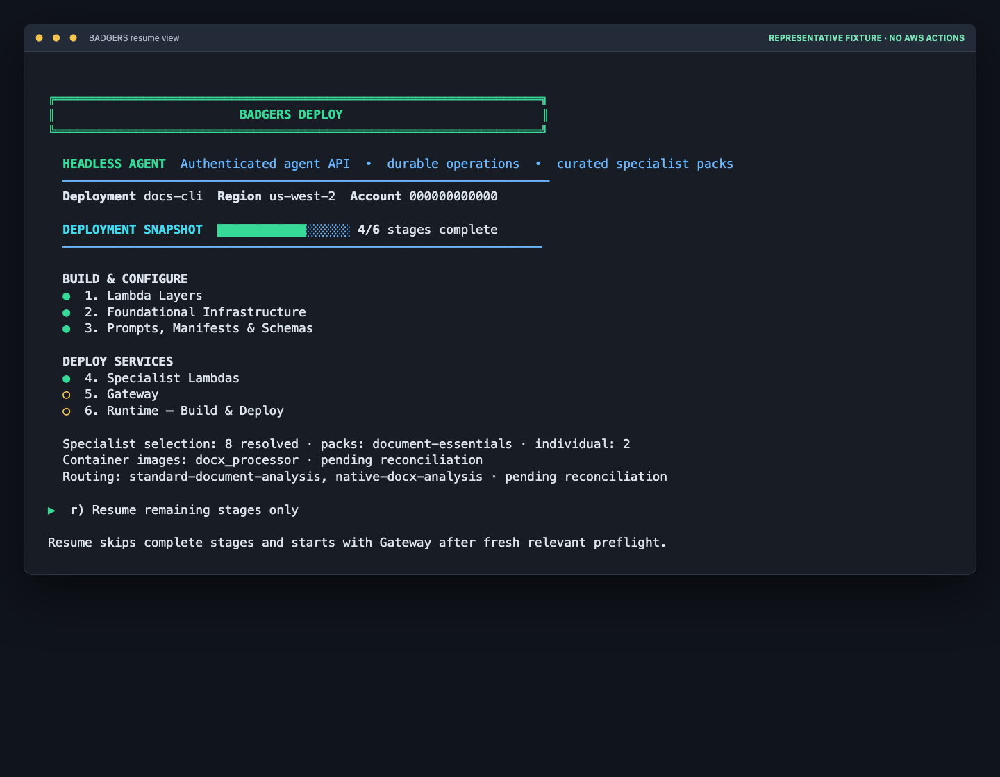

# Deployment Scripts

The two entry points live at the repository root. Everything under `deployment/` is a
helper invoked either by them or directly for targeted work.

This branch is the private, untagged `release/6.0.0-beta` candidate. A
deployment Step 3 configuration release is an S3 artifact for one deployment;
it is not a public source release. For the stable-tag, beta-publication, and
maintainer workflow, see the [Release Guide](../RELEASE_GUIDE.md).

All scripts resolve stack names through `deployment/scripts/common.sh`, which composes
`BADGERS-{Name}-{DEPLOYMENT_ID}-{suffix}` and reads `STACK_SUFFIX` from
`.deploy-state/{DEPLOYMENT_ID}.json`.

The two root entry points choose the deployment interactively. Every helper under
`deployment/` needs `DEPLOYMENT_ID` set in the environment, and `deploy.sh` must have run at
least once to create the state file.

## deploy.sh (repo root)

Interactive deployment menu, resumable and idempotent. Step completion is recorded in
`.deploy-state/{DEPLOYMENT_ID}.json`, so re-running after a failure continues from where
it stopped rather than starting over.

The terminal menu is profile-aware: it identifies the selected product and its capabilities,
groups actions into **Build & Configure**, **Deploy Services**, and **Launch**, and renders a
stage-progress bar. A green `●` is complete; a yellow `○` is still pending. This is display
only—the state file remains the source of truth and no deployment action is implied by viewing
the menu.

```bash
./deploy.sh           # choose Full, Headless, or Specialists; then choose a deployment
./deploy.sh 9         # choose a deployment, then run option 9 (full deployment)
./deploy.sh resume    # choose a deployment, then run only outstanding steps
./deploy.sh headless  # select Headless explicitly, then choose a deployment
./deploy.sh specialists --pack tables-and-forms 9
./deploy.sh specialists --specialist docx_processor 9
./deploy.sh configure --ui # loopback-only local configuration planner; no AWS actions
```

### Local configuration planner

Use `./deploy.sh configure --ui` to manage reusable packs, select specialists,
choose reviewed workflow-routing templates, and save an optional observability
posture before a deployment. The observability screen offers **links** (no new
resources), **baseline** (dashboard and operational alarms), or **enhanced**
(baseline plus business-health checks), with an optional SNS topic or
EventBridge bus ARN for notification handoff. Its footprint is a local
candidate estimate only: the future observability CLI deployer must inspect
live account inventory, service quotas, and destination permissions before it
creates AWS resources.

The planner starts a short-lived service on a random `127.0.0.1` port, opens a
browser, and stores only desired state in `.deploy-state/{DEPLOYMENT_ID}.json`.
It does not load AWS credentials, invoke the AWS CLI or CDK, run a shell
command, or create AWS resources.

The planner generates a reconciliation preview and a `deploy.sh … resume`
handoff command. Run that normal CLI command to select the deployment identity
and confirm the update; it repeats preflight and validates the desired state
before it changes AWS. Stop the planner with `Ctrl-C`.

**`DEPLOYMENT_ID` is unset on startup and never read from the environment.** The script
scans `.deploy-state/` and offers every deployment it finds — complete and in progress —
newest activity first, plus `n` to start a new one. A new id must match
`^[a-z][a-z0-9-]{0,15}$` and must not already have state; pick it from the list instead.

With a terminal, a bare `./deploy.sh` first presents the three supported
product profiles: Full, Headless, and Specialists. The product wrappers
(`badgers-full/deploy.sh`, `badgers-headless/deploy.sh`, and
`badger-specialists/deploy.sh`) select the corresponding profile explicitly.
Automated callers without a terminal retain the legacy Full default unless
they pass a profile argument or set `BADGERS_PROFILE`. `--pack` and
`--specialist` create an explicit, persisted selection for the chosen
deployment ID; they may be used with any current product profile. The future BADGERS Gateway MCP product has no deployment
profile or menu option until its implementation is complete.

Steps: 1 layers, 2 foundational infra, 3 upload config, 4 specialist Lambdas,
5 Gateway, 6 Runtime, 7 UI image, 8 UI ECS service. Then 9 full deployment, `r` resume,
10 status, 11 reset state (keeps the suffix, deletes nothing in AWS), `m` models (prints
the registry and which steps a registry edit requires), 0 exit.

For Headless, Step 3 is a release gate rather than merely an upload: it creates
the SHA-pinned workflow/routing/configuration artifact the durable runner uses.
The initial Headless workflow accepts PDF, PNG, and JPEG inputs. Its
customer-facing Agent API is authenticated; the separate BADGERS Gateway MCP
product is not exposed by this candidate.

Both Full and Headless create the VPC before Step 6, so the AgentCore Runtime
can run in private subnets with its dedicated security group. The optional Full
UI is internal by default; the menu requires an explicit `y` or
`UI_PUBLIC_ACCESS=true` to request an internet-facing UI.

**9 vs r** — both reach a complete deployment. Option 9 runs all eight steps and stops at
each completed one to ask whether to re-run. Option `r` skips completed steps before calling
them, so those prompts never fire, and starts at the first outstanding step.



> This is a representative local fixture. It shows how the current menu
> visualizes completed work and the remaining `r` path; it does not depict an
> AWS account or a live deployment.

Step 2 runs two Bedrock preflights before any stack is created, both driven by the model
registry: `preflight_model_access` checks each Converse model's `us.*` geo profile or
in-Region catalog availability, and `preflight_model_invocation` sends a minimal Converse
request (`"hi"`, 64 output tokens) to each compatible model as the operator and judges the
result by exit code. Mantle models, such as Gemma 4 31B, are reported but skipped because
they intentionally have neither inference profiles nor a Converse endpoint. Either failing stops the
deploy with the models named. The invocation preflight runs on *your* credentials, so for
the OpenAI models the deploying principal needs `bedrock:InvokeModel` on
`arn:aws:bedrock:{region}:{account}:project/default`, not only the Lambda role.

For a known infrastructure-only update, set `BADGERS_SKIP_MODEL_PREFLIGHT=1` when invoking
`deploy.sh`. This skips both account-wide model checks for that run only; it does not change
the default behavior and should not be used when changing the model registry or runtime.

Behaviour worth knowing:

- **Step 8 failure clears `ui_image_pushed`.** An ECS rollout usually fails because of
  something in the image, and redeploying the stack alone will not pick up a code change,
  so resume rebuilds in step 7 first. When the cause was external, that rebuild is a no-op.
- **Step 8 forces the image rollout** with `update-express-gateway-service` after the
  `cdk deploy`, because the stack pins a static image tag and pushing to that tag leaves
  the template unchanged.
- **The X-Ray decision is resolved before every `cdk deploy`**, not just in step 2 —
  `RuntimeWebSocket` depends on the XRay stack and `cdk deploy` includes dependencies.
- **Step 4 checks the foundation layer before building.** `lambdas/layer.zip` is a build
  artifact that nothing rebuilds automatically, so before the container build and the Lambda
  deploy, step 4 compares it against its sources (`badgers-foundation/foundation`,
  `config/config.py`, the core system prompts, and `lambdas/requirements.txt`). If it is
  missing or stale it names the newer file and prompts to rebuild (running
  `build_foundation_layer.sh`), and fails the step if you decline — replacing the raw CDK
  traceback the synth guard would otherwise throw. `BADGERS_ALLOW_STALE_LAYER=1` skips the
  prompt; `BADGERS_ASSUME_YES=1` rebuilds without asking. Step 6 (Runtime) needs no
  equivalent: it copies `foundation` source into the image and installs its own
  `runtime/requirements.txt`, so it never ships the pre-built layer.

Environment variables:

| Variable                                         | Effect                                                                                                                                                                                                                                                                                                             |
| ------------------------------------------------ | ------------------------------------------------------------------------------------------------------------------------------------------------------------------------------------------------------------------------------------------------------------------------------------------------------------------ |
| `BADGERS_ASSUME_YES`                             | `1` answers every confirmation with yes. Re-runs completed steps rather than skipping them — not a quiet resume. It is intended for controlled automation, not routine interactive use.                                |
| `UI_PUBLIC_ACCESS`                               | `true`/`false` answers the step 8 network-exposure prompt without asking.                                                                                                                                                                                                                                          |
| `BADGERS_SKIP_XRAY`                              | `1` omits the XRay stack regardless of the live state.                                                                                                                                                                                                                                                             |
| `BADGERS_SKIP_MODEL_PREFLIGHT`                   | `1` skips Step 2's account-wide Bedrock profile/catalog and Converse invocation checks for that run. Use only for a known infrastructure-only update; Mantle models are already skipped automatically because they do not use inference profiles or Converse. |
| `BADGERS_ALLOW_STALE_LAYER`                      | `1` lets the Lambda stack synthesize while `lambdas/layer.zip` is older than its sources, and skips step 4's pre-deploy freshness prompt. Without it, step 4 offers to rebuild and synth refuses outright, so a deploy cannot ship the previous layer. `destroy.sh` sets it itself, since a destroy ships nothing. |
| `BADGERS_SKIP_LOG_DELIVERY_PREFLIGHT`            | `1` skips the log-delivery preflight in steps 6 and 7 with a warning. The deploy will then fail with `AlreadyExists` if any conflicting delivery sources exist. See `scripts/common.sh`.                                                                                                                           |
| `UI_CONTAINER_PORT`                              | Container port sent with the forced rollout. Default `7860`; must match `CONTAINER_PORT` in `stacks/ecs_stack.py`.                                                                                                                                                                                                 |
| `IMAGE_TAG`, `RUNTIME_IMAGE_TAG`, `UI_IMAGE_TAG` | Image tags. Default `latest`, `websocket`, `frontend`.                                                                                                                                                                                                                                                             |

## destroy.sh (repo root)

Full teardown. Requires typing the `DEPLOYMENT_ID` to confirm.

```bash
./destroy.sh                                                   # choose from what is deployed
DEPLOYMENT_ID=dev ./destroy.sh                                 # explicit, validated against AWS
KMS_WAIT_DAYS=30 ./destroy.sh                                  # longer KMS window
DEPLOYMENT_ID=dev STACK_SUFFIX=a1b ./destroy.sh --vpc-cleanup-only
```

With no `DEPLOYMENT_ID` it **discovers deployments from CloudFormation**, not from
`.deploy-state/` — a state file can be deleted while the stacks are still live, so the
stacks are authoritative. Identity is parsed out of the stack names, so it works even for a
partial deployment. Passing `DEPLOYMENT_ID` explicitly is validated against the naming rules
and against what exists; if nothing matches `BADGERS-*-{id}-{suffix}` it refuses rather than
running a teardown that does nothing.

Order matters and the script enforces it: empty the buckets, delete the ECS Express service
and the AgentCore runtime and wait for their ENIs to release, then destroy the stacks in
reverse dependency order. CloudFormation cannot delete a VPC while an ENI is attached, which
is why the compute goes first.

- The ECS service is deleted with **`delete-express-gateway-service`**. `delete-service`
  rejects it with *"has ResourceManagementType=ECS use DeleteExpressGatewayService"*.
- AgentCore calls target **`bedrock-agentcore-control`**. The `bedrock-agentcore` service
  only exposes `InvokeAgentRuntime`, so control-plane calls aimed there fail silently.
- If the VPC stack is `DELETE_FAILED` it retries with `--retain-resources`, sweeps ENIs
  again, then re-verifies.
- The KMS key is scheduled **only after** the stacks are confirmed gone (7 days by default,
  which frees the alias sooner than the 30-day maximum). Scheduling it after a failed
  teardown would mark a live deployment's in-use key for deletion.
- Verification does not trust the script's own stack list: it also queries CloudFormation
  for anything matching `BADGERS-*-{id}-{suffix}` and reports a stack it did not expect,
  so a stack added to the app and forgotten here cannot survive under a "complete" banner.
- A teardown leaving stacks standing prints `❌ Teardown incomplete`, lists them, states
  that the KMS key was left alone, and **exits non-zero**.
- `cdk destroy` synthesizes the app first. The script sets `BADGERS_ALLOW_STALE_LAYER=1`
  for that synth, because the Lambda stack's stale-layer guard is about deploys and a
  destroy ships nothing; a teardown from a tree with an old `layer.zip` used to abort on
  that guard with every stack still standing.
- Bedrock model-access subscriptions are account-level and are left alone; the script says
  so at the end rather than implying a clean account.

`--vpc-cleanup-only` runs just the ENI sweep: deletes interface endpoints, then deletes
or force-detaches whatever ENIs remain. Use it when a previous teardown left a VPC behind.
It skips discovery, so it needs both `DEPLOYMENT_ID` and `STACK_SUFFIX`.

For tearing down by hand, see
[Manual Teardown in the Console](DEPLOYMENT_README.md#️-manual-teardown-in-the-console).

## deploy_specialist.sh

Deploys a single specialist without redeploying everything. An arrow-key picker lists the
specialists under `lambdas/code/`, shows which supporting files exist (manifest, schema,
prompts), validates completeness, then:

1. Uploads that specialist's S3 files to the config bucket
2. Deploys the Lambda stack (creating the new function)
3. Deploys the Gateway stack (wiring the Lambda as a target)

Uses `--exclusively` to avoid cascading into unrelated stacks.

```bash
DEPLOYMENT_ID=dev ./deploy_specialist.sh
```

## deploy_specialist_container.sh

Builds and pushes a single container-based specialist image, then updates its function.

## deploy_custom_specialists.sh

Deploys the CustomSpecialists stack from the **local** `custom_specialists/` tree. It does
not touch S3: it reads `custom_specialists/specialist_registry.json`, exits cleanly with a
warning if that file is missing or lists no specialists, resolves `DEPLOYMENT_ID` from the
deployed stacks, then runs `cdk deploy --exclusively` on the CustomSpecialists stack. That
stack only exists when the registry is present.

This is what `POST /api/wizard/deploy` spawns, streaming its output over SSE.

## sync_s3_files.sh

Syncs the whole `s3_files/` directory to the deployed config bucket. Equivalent to step 3
of `deploy.sh`, useful on its own after editing a prompt.

## sync_custom_specialists.sh

Pulls wizard-created specialists down from S3 into `custom_specialists/` so the CDK app
can see them.

## scripts/generate_ui_env.sh

Writes `ui/.env`, the single UI env file, from the deployed stacks. Two kinds of value
land in it: the `VITE_*` Cognito values, which Vite bakes into the bundle at build time
(it only exposes `VITE_`-prefixed variables), and the local-development runtime values
read by `ui/server/index.js` — bucket names, the Runtime ARN, the Gateway ID, the jobs
table. Must run after Cognito is deployed and before the UI image is built; `deploy.sh`
step 7 calls it. Operator-owned lines (`AWS_PROFILE`, `CORS_ALLOWED_ORIGIN`,
`BADGERS_UI_ROLE`, `WS_TIMEOUT_MINUTES`) are carried over on regeneration. The deployed
container reads the runtime values from SSM Parameter Store instead; `ui/.env` is never
copied into the image.

## cleanup-stack.sh

Targeted recovery for a wedged AgentCore Runtime stack: deletes the runtime, then the
stack. `destroy.sh` does this as part of a full teardown; use this when only the runtime
stack is stuck.

## scripts/common.sh

Sourced by the scripts above rather than executed. Provides logging, the deployment state
file helpers, `_sn` for stack names, `resource_id` for resource names, CloudFormation
output lookups, and the CDK wrappers.

### Log-delivery preflight

`preflight_log_delivery` runs in `step_gateway` and `step_runtime`. **It can stop the
deploy, and it prompts.**

A CloudWatch `DeliverySource` is unique per `(resourceArn, logType)`, not per name, so only
one may exist for a given AgentCore resource and log type — whoever created it.
CloudFormation creates new resources before deleting removed ones, so during an update both
spellings exist at once, collide, and the deploy fails with *"This ResourceId has already
been used in another Delivery Source in this account"* (`AlreadyExists`). Renaming cannot
fix it.

Two ways a foreign source gets there: enabling log delivery by hand in the console leaves
`WdDeliverySource-*` entries, and a stack that previously used the CDK logging mixin leaves
`cdk-<type>-source-<hash>` entries. Anything this deployment created is named
`badgers-<deployment>-*` and is left alone.

| Function                        | Behaviour                                                                                                                                                            |
| ------------------------------- | -------------------------------------------------------------------------------------------------------------------------------------------------------------------- |
| `logs_foreign_delivery_sources` | Echoes `name<TAB>logType` per occupied slot, scoped by the exact `GatewayArn`/`RuntimeArn` this deployment publishes. Emits `!ERROR<TAB>reason` when it cannot tell. |
| `logs_delete_delivery_source`   | Deletes the referencing delivery first, then the source — the delivery holds the reference.                                                                          |
| `preflight_log_delivery`        | Lists what is in the way with a per-entry origin, prompts, remediates on confirmation, re-verifies, and returns non-zero if anything remains.                        |

Removing a delivery source deletes **delivery configuration only** — log groups and
everything already written to them are untouched. Log and trace delivery stops until the
deploy finishes.

It returns non-zero, stopping the deploy, both on decline and on `!ERROR`: "could not
determine" is not "clear to proceed", and stopping costs a re-run where proceeding costs a
failed stack update partway through.

In `step_runtime` the check runs after `ecr_login` but **before** the image build, so a
conflict does not surface after several minutes of building.

Required IAM: `logs:DescribeDeliverySources` to check, plus `logs:DescribeDeliveries`,
`logs:DeleteDelivery`, and `logs:DeleteDeliverySource` to remediate. Missing permission
takes the `!ERROR` path and is a hard stop.

> [!IMPORTANT]
> `BADGERS_ASSUME_YES=1` answers this prompt too (`_confirm` returns yes without reading
> stdin), so **it deletes the conflicting delivery sources without asking.** An unattended
> invocation therefore remediates silently. Use
> `BADGERS_SKIP_LOG_DELIVERY_PREFLIGHT=1` instead if the sources must be preserved — the
> deploy will then fail on `AlreadyExists`.
>
> An unattended invocation that sets neither will block on the prompt. The `!ERROR` path
> stops the deploy regardless of `BADGERS_ASSUME_YES`, since it returns before prompting.
