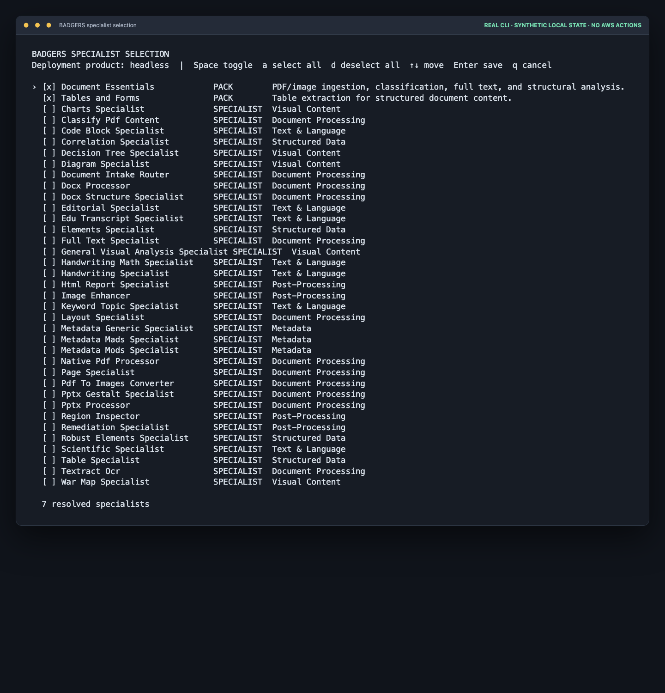
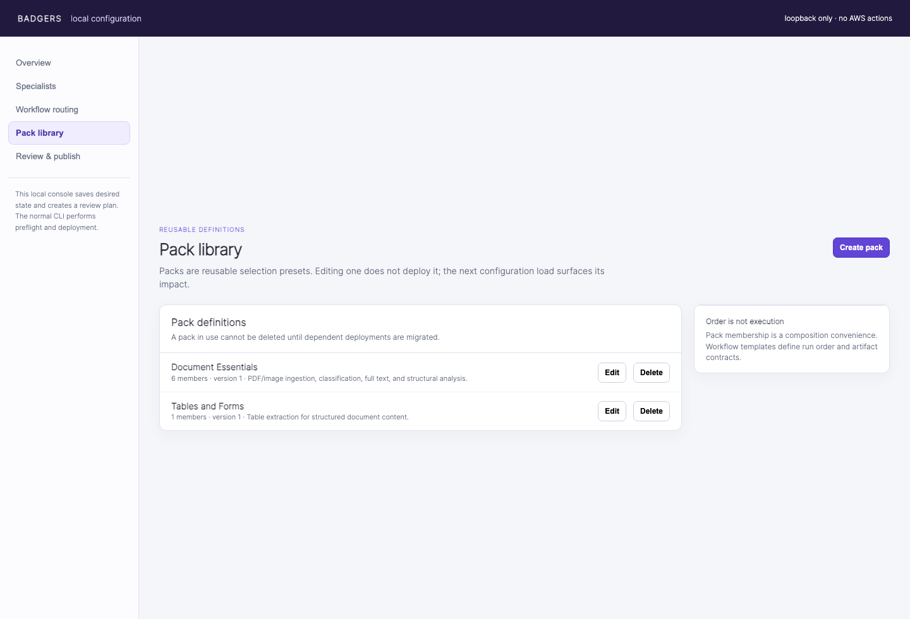

[← BADGERS home](../../README.md)

# BADGERS deployment profiles

Profiles are declarative deployment inputs. They resolve a named product
offering into an explicit specialist set and capability map before CDK or AWS
resource creation.

## Choose a profile

| Profile | Best for | Includes | Definition |
| --- | --- | --- | --- |
| Full | Operating the complete BADGERS application | Agent, Gateway, all enabled specialists, UI, session memory, and operations tooling | [`full.json`](full.json) |
| Headless | Integrating BADGERS into your own application or workflow | Authenticated agent API, curated PDF/image packs, durable runner, and operation state | [`headless.json`](headless.json) |
| Specialists | Calling document analyzers directly from AWS code | Selected direct-invocation Lambda packs and their shared foundation | [`specialists.json`](specialists.json) |

Use this reference to inspect or change profile definitions. To deploy a
profile, start with [BADGERS Full](../../badgers-full/README.md),
[BADGERS Headless](../../badgers-headless/README.md), or
[BADGERS Specialists](../../badger-specialists/README.md).

On `release/6.0.0-beta`, profiles are part of a private release candidate. The
stable customer source release is `v5.0.2`; the beta branch has no public
release tag. See the repository [Release Guide](../../RELEASE_GUIDE.md) for
the source-release and publication policy.

```bash
./.venv/bin/python deployment/profile_resolver.py full
./.venv/bin/python deployment/profile_resolver.py headless

# Guided menu for the Headless product
./deploy.sh headless

# Non-interactive profile selection; option 9 runs all applicable steps
./deploy.sh headless 9

# Direct Lambda specialist pack; no agent runtime or Gateway
./deploy.sh specialists --pack tables-and-forms --specialist docx_processor 9
```

`full.json` intentionally selects every specialist enabled by the existing
`deployment_config.json`, preserving today’s deployment behavior.

`headless.json` selects curated specialist packs and is wired into the
deployment engine. Headless synthesizes and deploys its selected specialists,
agent runtime, Gateway, Cognito machine identity, storage, model profiles, and
the minimal DynamoDB operation ledger and private workflow runner. It omits
ECS, VPC, UI image build, specialist wizard, session memory, X-Ray Transaction
Search, and WebSocket handler registration. The initial Headless workflow is
limited to the curated PDF/image capabilities by default. Native DOCX/PPTX
processors can be selected explicitly; their container build and ECR
requirements are derived automatically from that selection.

Headless stages only the shared agent/prompt core and the selected
specialists' schemas, manifests, and prompts before uploading configuration.
It does not sync the entire specialist catalog to its configuration bucket.
Each deployment ID is bound to one product profile in `.deploy-state`; use a
new ID rather than attempting to convert an existing Full deployment in place.

Every complete Step 3 upload builds a deterministic `release-manifest.json`,
hashes its profile resolution and staged file contents, uploads the result
under `releases/<sha256>/`, and stores the SHA in deployment state. Later CDK
steps pass that release prefix to specialist functions, Gateway schemas, and
the agent runtime. Re-run dependent deployment steps after a configuration
release changes so their pinned prefix advances together.

This is a **configuration release**, not a Git release: it is private to one
deployment and pins runtime configuration. A customer source release is an
immutable Git tag such as `v5.0.2`; the future 6.0 beta tag must be explicitly
approved before publication. See [Release terminology](../../RELEASE_GUIDE.md#release-terminology).

Specialist packs live under `specialist_packs/`. A pack is a named, ordered
selection of existing specialists. The resolver validates that each selected
specialist exists and is enabled in the current deployment configuration.

Every deployment has a persisted desired selection. Use `s` in the deployment
menu to toggle packs and individual specialists with Space, press `a` to select
all, `d` to deselect all, then press Enter to save. Use `k` to create, edit, or safely delete reusable packs. `--pack` and
`--specialist` provide the same explicit selection for scripted runs. A changed
selection keeps its deployment ID and reconciles the dependent configuration,
Lambda, Gateway, and runtime stages on the next deploy.



> This sanitized capture uses synthetic local state. `a` selects all visible
> choices; `d` deselects all. The picker does not create AWS resources.

Every agent profile also has a persisted desired routing configuration. Use `w`
to choose validated templates: the default PDF/image workflow, plus native
DOCX and PPTX workflows when their processors are selected. The optional
`./deploy.sh configure --ui` planner presents both desired-state records in one
local review flow. It saves no AWS state and hands execution back to `deploy.sh`.


