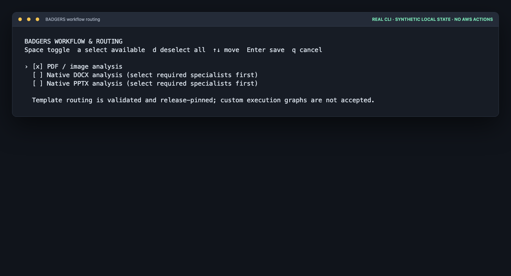

[← BADGERS home](../../../README.md)

# BADGERS workflow definitions

Workflow files are declarative, release-pinned configuration. A workflow
chooses invariant steps, allowed capability tags, supported routing modes, and
one routing policy. It must not contain a Lambda ARN, role ARN, URL, script, or
customer-supplied executable code.

The deployment menu's **w) Configure workflow routing** selection, and the
optional `./deploy.sh configure --ui` planner, write release-pinned workflow
definitions from supported templates. Templates are deliberately fixed rather
than arbitrary executable graphs:

| Template | Input | Execution |
| --- | --- | --- |
| `standard-document-analysis` | PDF, PNG, JPEG | Page conversion, classification, approved page specialists, correlation |
| `native-docx-analysis` | DOCX | Selected `docx_processor`, then a private result artifact |
| `native-pptx-analysis` | PPTX | Selected `pptx_processor`, then a private result artifact |
| `native-xlsx-analysis` | XLSX | `xlsx_processor`, producing canonical BADGERS XML plus private native and conditional Vision evidence |

The native templates are available only after selecting their processor. In an
agent product, an omitted workflow ID is routed from the configured source
content type; an explicit workflow ID always wins. The Specialists product has
no workflow runner and therefore has no routing template.

> This sanitized capture uses synthetic local state. `a` enables every
> currently compatible template; `d` clears the selection. An agent profile
> still requires at least one template before it can be deployed.

It is staged inside a deployment-private configuration release; it is not a
published Git source release. See the repository
[Release Guide](../../../RELEASE_GUIDE.md).

Each file name must equal its `workflow_id`, for example
`standard-document-analysis.json`. The staging process validates every
workflow against the selected product profile before it creates the immutable
release. A capability must be both allowed by the workflow and supplied by the
selected specialist pack.

`invariant_capabilities` maps execution invariants to capability tags. Manual
capability selection is permitted only where the workflow explicitly enables
it, and the selection must include all invariant capabilities. Auto plans use
classifier facts and the referenced routing policy to add approved work.
